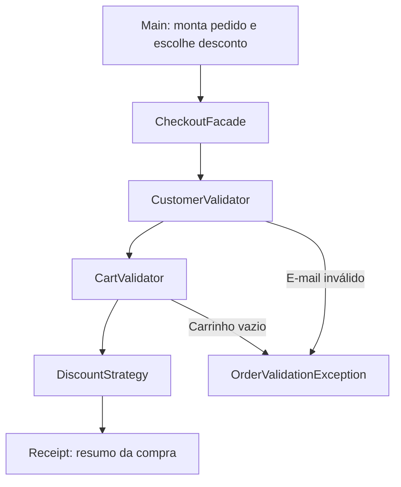

# Checkout Patterns 🛒

Simulação de checkout em **Java 17**, criada para o desafio **Explorando Padrões de Projetos na Prática com Java**, da DIO. O projeto aplica três padrões a um mesmo problema: validar um pedido e calcular seu total com diferentes descontos.

## O que o projeto faz

- Calcula o subtotal de produtos considerando preço e quantidade.
- Alterna entre compra sem desconto e desconto percentual.
- Valida o cliente e o carrinho em uma sequência de regras.
- Retorna um resumo com subtotal, desconto e total.
- Demonstra um pedido recusado e cobre as regras com testes automatizados.

É uma aplicação de console em Java puro, sem dependências de execução. Não realiza pagamentos, não consulta estoque e não persiste pedidos. O e-mail recebe apenas uma validação básica de formato.

## Executar

Requisitos: **JDK 17** e **Maven 3.9 ou superior** no PATH. A primeira compilação precisa de internet para baixar os plugins do Maven e o JUnit.

```shell
mvn clean verify
java -jar target/checkout-patterns-1.0.0.jar
```

A aplicação executa três cenários fixos, sem solicitar dados pelo terminal:

```text
Compra sem desconto
Subtotal: R$ 300,00 | Desconto: R$ 0,00 | Total: R$ 300,00

Compra com desconto de 10%
Subtotal: R$ 300,00 | Desconto: R$ 30,00 | Total: R$ 270,00

Pedido recusado: O carrinho deve conter pelo menos um item.
```

Para rodar somente os testes:

```shell
mvn test
```

## Padrões aplicados

| Padrão | Implementação | Problema resolvido |
| --- | --- | --- |
| **Strategy** (comportamental) | `DiscountStrategy`, `NoDiscount` e `PercentageDiscount` | Trocar a regra de desconto sem modificar a fachada. |
| **Chain of Responsibility** (comportamental) | `OrderValidator`, `CustomerValidator` e `CartValidator` | Encadear verificações e interromper o processamento na primeira falha. |
| **Facade** (estrutural) | `CheckoutFacade` | Oferecer uma única operação para coordenar a validação e o cálculo do pedido. |



A fachada inicia a cadeia de validação e, se todas as regras passarem, chama a estratégia escolhida. Os validadores não calculam descontos e as estratégias não validam clientes.

## Exemplo de uso

```java
var order = new Order("cliente@example.com", List.of(
    new Item("Livro", new BigDecimal("80.00"), 2)
));

var checkout = new CheckoutFacade();
var receipt = checkout.checkout(order, new PercentageDiscount(new BigDecimal("10")));
System.out.println(receipt.total()); // 144.00
```

As classes estão em `br.com.designpatterns.checkout` e seus subpacotes `domain`, `facade` e `strategy`; `List` e `BigDecimal` pertencem à biblioteca padrão do Java.

## Organização

```text
src/
├── main/java/br/com/designpatterns/checkout/
│   ├── Main.java
│   ├── domain/       # Item, Order e Receipt
│   ├── facade/       # Coordenação do checkout
│   ├── strategy/     # Políticas de desconto
│   └── validation/   # Cadeia de validação
└── test/java/br/com/designpatterns/checkout/
    └── CheckoutTest.java
.github/workflows/java-ci.yml
pom.xml
```

## Decisões de implementação

- **Valores monetários:** `BigDecimal`, construído a partir de strings, evita imprecisões de ponto flutuante. Preços aceitam até duas casas decimais significativas; o desconto percentual é arredondado para centavos com `HALF_UP`.
- **Imutabilidade:** records e cópia defensiva da lista impedem alterações acidentais nos itens de um pedido.
- **Proteção do total:** a fachada rejeita descontos negativos ou superiores ao subtotal, inclusive em estratégias personalizadas.
- **Composição:** as dependências são objetos Java comuns. Não há framework ou Singleton, pois o exemplo não precisa de estado global.
- **Escopo:** a fachada representa uma simulação de checkout. Uma integração real de pagamento exigiria regras e tratamento de falhas adicionais.

## Como evoluir

Uma nova classe que implemente `DiscountStrategy` pode oferecer outra política de desconto. Por exemplo, uma estratégia de desconto fixo deve limitar o benefício ao subtotal. Para acrescentar uma validação, estenda `OrderValidator` e inclua o novo elo na cadeia montada pela fachada.

Os testes verificam cálculo com quantidades, arredondamento, desconto integral, estratégias personalizadas, rejeição de dados inválidos, ordem das validações e imutabilidade. O workflow do GitHub Actions compila, testa e executa a demonstração a cada push e pull request.

## Publicar no GitHub

Crie um repositório vazio chamado `checkout-patterns` na sua conta, sem README inicial. Depois, nesta pasta, execute os comandos abaixo. Substitua `SEU_USUARIO` pelo seu usuário do GitHub:

```shell
git init -b main
git add .
git commit -m "feat: implementa checkout com design patterns"
git remote add origin https://github.com/SEU_USUARIO/checkout-patterns.git
git push -u origin main
```

Descrição sugerida para o repositório:

> Simulação de checkout em Java 17 com Strategy, Chain of Responsibility e Facade, testes com JUnit e integração contínua.

Topics sugeridos: `java`, `design-patterns`, `strategy-pattern`, `chain-of-responsibility`, `facade-pattern`, `junit`, `dio`.

## Referências

Implementação própria para praticar os conceitos propostos no desafio. Os laboratórios oficiais servem como material complementar de estudo:

- [DIO — Padrões de Projeto com Java Puro](https://github.com/digitalinnovationone/lab-padroes-projeto-java)
- [DIO — Padrões de Projeto com Spring](https://github.com/digitalinnovationone/lab-padroes-projeto-spring)
